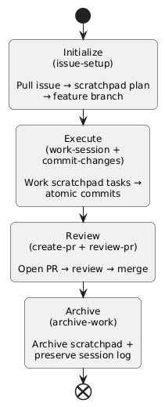
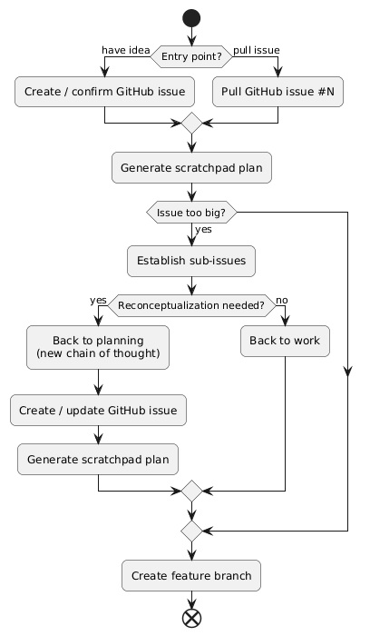
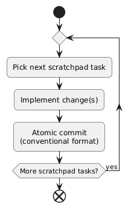
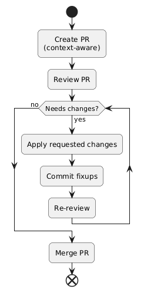
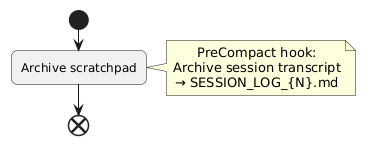
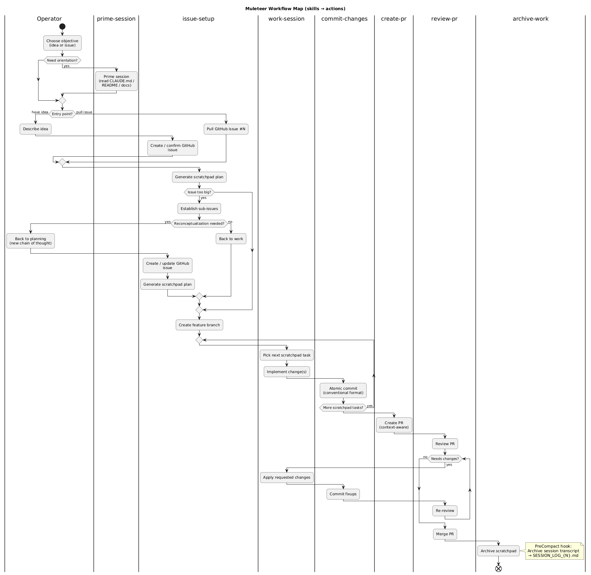

# Escapement

**Claude Code plugin for structured development workflows.** Regulated workflow, one tick at a time.

## What This Is

Escapement is an opinionated workflow and Claude Code plugin that provides reusable modules to streamline your development process:

- **Meta-workflow**: A prescribed sequential process supported by the plugin modules
- **Skills**: Automated workflow modules (issue setup, commits, PRs, etc.)
- **Hooks**: Session archiving on compaction
- **Agents**: Specialized AI assistants (scratchpad-planner for codebase analysis, validation-reviewer for factory attempts)
- **Multi-Project Support**: Works across all your repos simultaneously

## Workflow Overview

Escapement guides you from idea to merged code through a structured workflow:

1. **Initialize** (`setup-work`) - Pull GitHub issue → Generate scratchpad plan → Create feature branch
2. **Execute** (`do-work` + `commit-changes`) - Work through scratchpad tasks → Make atomic commits
3. **Review** (`create-pr` + `review-pr`) - Create pull request → Review changes → Merge
4. **Archive** (`archive-work`) - Clean up scratchpad → Preserve session history



Each phase is handled by specialized skills that activate via natural language or explicit commands.

## Installation

### From Source (Development)

```bash
# Clone the repository
git clone https://github.com/fusupo/escapement.git

# Run Claude Code with the plugin
claude --plugin-dir /path/to/escapement
```

### Manifest Skills (Optional)

The `manifest-*` skills run a TypeScript CLI in the plugin's `manifest/` directory. Its dependencies aren't committed, so install them once in the plugin directory, not in your project (needs Node.js and a C/C++ build toolchain for `better-sqlite3`):

```bash
cd /path/to/escapement/manifest && npm ci
```

Skills run the CLI through `scripts/manifest.sh`, which works from any project directory. `bash /path/to/escapement/scripts/manifest.sh --check` reports whether the dependencies are installed.

The same install covers the factory runner, `scripts/factory.sh`, which is being built for contract-driven validation loops ([docs/FACTORY_DESIGN.md](docs/FACTORY_DESIGN.md)). Its commands and `--json` output are documented in [docs/FACTORY_CLI.md](docs/FACTORY_CLI.md).

### From Marketplace (Coming Soon)

```bash
# Once published to a marketplace
/plugin install escapement
```

## Usage

### High-Level Workflow

Work proceeds through four phases:

* **Initialize**: establish scope and plan
* **Execute**: implement planned work in small steps
* **Review**: validate and merge changes
* **Archive**: preserve artifacts and session history

The phases are sequential but not strictly linear; refinement can push work backward before execution begins.

### Initialize (`prime-session`, `setup-work`)

The session begins either from an idea or an existing GitHub issue.

If needed, project context is loaded by reading `CLAUDE.md` and related documentation.
An issue is created or fetched, then analyzed to produce a scratchpad plan.

If the issue is too large, it is decomposed into sub-issues.
If assumptions are invalid, the issue may be reworked before proceeding.

A feature branch is created once the plan is acceptable.

Operator involvement is primarily directional: clarifying intent and approving scope.



### Execute (`do-work`, `commit-changes`)

Work is driven by the scratchpad.

Tasks are selected one at a time, implemented, and committed as atomic changes following project conventions.
This loop continues until the scratchpad is complete.

The operator may intervene to adjust task order, clarify intent, or pause execution, but most actions are automated.



### Review (`create-pr`, `review-pr`)

A pull request is created with full context from the scratchpad and commit history.

The PR is reviewed.
If changes are requested, work resumes and new commits are added before re-review.

This cycle repeats until the changes are accepted and merged.

Operator involvement is typically focused on decision-making and judgment rather than mechanics.



### Archive (`archive-work`, hooks)

After merge, the scratchpad is archived.

Before Claude Code compacts the session, the PreCompact hook saves the conversation since the last session log; `archive-work` saves the rest when it archives.
This preserves planning, execution, and review context as durable artifacts.

The session is then considered complete.



### Full Workflow Map

This diagram shows all phases together, with swimlanes for each skill and the operator.

It illustrates where decisions occur, which actions are automated, and how control moves between skills over the life of a session.



## Skills

Skills are invoked automatically by Claude Code when relevant, or you can reference them explicitly with the `/escapement:` prefix:

**Natural Language Invocation:**
```bash
# Claude uses the skill automatically based on context
"Setup GitHub issue #42"
"Commit these changes"
"Create a PR for this branch"
```

**Explicit Invocation:**
```bash
/escapement:setup-work
/escapement:commit-changes
/escapement:create-pr
```

### Available Skills

| Skill            | Triggers                            | Purpose                                        |
| ---------------- | ----------------------------------- | ---------------------------------------------- |
| `setup-work`     | "setup issue #X", "start issue #X"  | Fetch issue, create scratchpad, prepare branch; on projects set up for the factory, also draft a validation contract and offer to authorize a run |
| `commit-changes` | "commit", "commit these changes"    | Smart commits with conventional format; under an authorized factory run, without asking, as the AI agent |
| `create-pr`      | "create a PR", "open pull request"  | Context-aware PR creation; under an authorized run, through `factory pr` with the validation report |
| `review-pr`      | "review PR #X", "check this PR"     | Roadmap-aware code review                      |
| `do-work`        | "start working", "continue work"    | Execute tasks from scratchpad; under an authorized run, from approved plan to open PR with no questions |
| `validate-work`  | "validate this work", "record the manual check" | Validate a factory run: checks, fresh-context reviewer, recorded verdict; manual outcomes |
| `archive-work`   | "archive this work", "clean up"     | Move completed scratchpads to archive; archive and close a factory run |
| `create-issue`   | "create an issue", "file a bug"     | Ad hoc GitHub issue creation from natural language |
| `stash-artifact` | "stash this script", "save to context" | Save artifacts to context directory         |
| `prime-session`  | "orient me", "what is this project" | Read project docs for context                  |
| `manifest-bootstrap` | "bootstrap the manifest"       | Build manifest dependency graph from GitHub issues |
| `manifest-plan`  | "plan the dispatch"             | Generate dispatch plan with parallel groups and overlaps |
| `manifest-sync`  | "sync the manifest", "mark work done" | Mark items done, record actuals, recompute frontier |
| `manifest-check` | "check manifest health"         | Detect stale items, reconcile predictions, find drift |
| `manifest-dispatch` | "dispatch work"              | Create worktrees, constraint blocks, launch parallel agents |

### Manifest Skills

The `manifest-*` skills are an optional layer for running several issues in parallel. The core workflow above handles one issue at a time and never calls them.

The manifest is a SQLite dependency graph of a project's open issues, recording which issues block which and which files each is expected to touch:

1. **`manifest-bootstrap`** builds the graph from open GitHub issues and a codebase analysis
2. **`manifest-plan`** finds the issues whose dependencies are done and groups those that don't touch the same files
3. **`manifest-dispatch`** does `setup-work`'s job for a whole group: a worktree, branch, scratchpad and file-ownership constraints per issue, then launches an agent for each
4. **`manifest-sync`** runs after `archive-work`: it marks the item done, records the archive path and the files actually changed, and recomputes what is ready next
5. **`manifest-check`** can run at any time to catch drift: new issues, superseded items, wrong file predictions

The skills need the CLI's dependencies installed (see [Manifest Skills (Optional)](#manifest-skills-optional)) and the database lives under the context path. Until [#58](https://github.com/fusupo/escapement/issues/58) is fixed, the CLI always uses Escapement's own database, whichever project it runs in. Design: `docs/MANIFEST_SYSTEM_DESIGN_V2.md`.

## Hooks

Escapement includes a **PreCompact hook** that captures your raw session transcript before Claude Code compacts it (auto or manual). The hook writes only the conversation since the previous log to `SESSION_LOG_{N}.jsonl` in the **project root**, so a long session spanning many issues doesn't repeat itself in every log. See [Session Archiving](docs/SESSION-ARCHIVING.md#what-a-session-log-covers) for exactly what each log covers.

The `archive-work` skill later saves the session's tail since the last log, converts the `.jsonl` files to readable markdown (using `scripts/convert-session-log.py`), and moves them to the archive directory.

**Requirements:** `jq` must be installed for the hook to function.

A **PreToolUse hook**, `factory-exec-guard.sh`, keeps a factory run's builds and tests on the shared build lock. It acts only in a worktree whose run is being implemented under an authorization (a marker the runner keeps inside `.git`), and refuses the project's `static` and `verify` commands unless they go through `factory exec`. Everywhere else it exits at once. A project opts out with `exec-hook: off` in its Escapement Settings. See [FACTORY_CLI.md](docs/FACTORY_CLI.md#the-exec-guard).

## Agents

Specialized subagents for delegation and deep analysis:

### scratchpad-planner

**Automatically invoked** during `setup-work` (Phase 2) for codebase analysis and implementation planning.

**Capabilities:**
- Reads project's CLAUDE.md for conventions and structure
- Analyzes codebase using Grep, LSP, and code search patterns
- Identifies affected modules and integration points
- Finds similar implementations to learn from
- Generates atomic task breakdowns following project conventions
- Asks clarifying questions for ambiguous requirements
- Supports resumable analysis for complex codebases

**Benefits:**
- **Specialized expertise**: Replaces generic exploration with focused planning methodology
- **Project awareness**: Adapts to each project's conventions and architecture
- **Resumability**: Can be resumed across sessions for iterative refinement
- **Context preservation**: Maintains full analysis context, reducing repetition

The scratchpad-planner agent transforms GitHub issues into concrete, well-structured implementation plans with atomic, reviewable tasks.

### validation-reviewer

A fresh-context reviewer for a factory attempt awaiting review. Given the `bundle.json` that `factory.sh review-input` writes, it does three things:
- judges whether each piece of evidence demonstrates its criterion;
- signs off sensitive and execution-policy changes;
- justifies modified assertions.

It writes a verdict file and never edits code. The host records the verdict with `factory.sh record-review`, which rejects an incomplete one.

The agent is a thin wrapper: the reviewer's instructions are `prompts/factory/validation-reviewer.md`, runtime-neutral data that any host can run (`factory.sh prompt reviewer`). See `docs/FACTORY_CLI.md`.

## Structure

```
escapement/
├── .claude-plugin/
│   └── plugin.json           # Plugin manifest
├── skills/
│   ├── setup-work/           # GitHub issue -> scratchpad workflow
│   ├── commit-changes/       # Conventional commits
│   ├── create-pr/            # Pull request creation
│   ├── review-pr/            # PR review
│   ├── do-work/              # Execute from scratchpad (authorized factory path)
│   ├── validate-work/        # Validate a factory run: checks, reviewer, verdict
│   ├── archive-work/         # Archive completed work (context-path aware)
│   ├── create-issue/         # Ad hoc GitHub issue creation
│   ├── stash-artifact/       # Save artifacts to context directory
│   ├── prime-session/        # Project orientation
│   ├── manifest-bootstrap/   # Bootstrap manifest dependency graph
│   ├── manifest-plan/        # Generate dispatch plan with parallel groups
│   ├── manifest-sync/        # Sync manifest after work completion
│   ├── manifest-check/       # Manifest health checks and drift detection
│   └── manifest-dispatch/    # Dispatch parallel work from manifest plan
├── hooks/
│   ├── hooks.json            # Hook configuration
│   ├── archive-session-log.sh # PreCompact hook (JSONL slice)
│   └── factory-exec-guard.sh  # PreToolUse hook: a run's checks go through factory exec
├── manifest/                 # Manifest and factory CLIs (TypeScript, SQLite)
│   ├── manifest-cli.ts       # Manifest entry point; run it through scripts/manifest.sh
│   ├── factory-cli.ts        # Factory runner entry point; run it through scripts/factory.sh
│   ├── factory/              # Runs, locks, exec, resume, settings, tiers, schemas, readiness, validate, review, authorization, GitHub, pr, manual, archive, guard
│   ├── init.ts               # Database setup and context-path resolution
│   ├── plan.ts               # Dispatch plan generation
│   ├── migrations.ts         # Ordered schema migrations (PRAGMA user_version)
│   ├── schema.sql            # Migration 1: work items and edges
│   ├── migrations/           # Later migrations (002: factory tables)
│   ├── queries/              # SQL for frontier, overlap, reconcile, etc.
│   └── test-*.ts             # Tests (`npm run test:*`, run one at a time)
├── scripts/
│   ├── convert-session-log.py # JSONL→markdown session log converter
│   ├── get-context-path.sh    # Shared context-path parser for skills
│   ├── manifest.sh            # Runs the manifest CLI from any project directory
│   ├── factory.sh             # Runs the factory CLI from any project directory
│   ├── migrate-archives.py    # Migrate in-repo archives to context-path
│   └── slice-session-log.sh   # Transcript slicing with a per-session cursor
├── schemas/factory/          # Published JSON Schemas: contract, report, verdict, readiness
├── prompts/factory/          # Agent prompts the factory ships as data (validation-reviewer)
├── agents/                   # Specialized subagents
│   ├── scratchpad-planner.md # Codebase analysis for setup-work
│   └── validation-reviewer.md # Claude Code wrapper for the factory reviewer prompt
├── docs/                     # Extended documentation
│   ├── WORKFLOW.md           # Workflow explanation
│   ├── CUSTOMIZATION.md      # How to customize
│   ├── CONTEXT_PATH.md       # Context path design and usage
│   ├── SESSION-ARCHIVING.md  # What session logs cover and how they're archived
│   ├── MANIFEST_SYSTEM_DESIGN_V2.md # Manifest design (current)
│   ├── MANIFEST_SYSTEM_DESIGN.md    # Manifest design (original, superseded by V2)
│   ├── FACTORY_DESIGN.md     # Design for contract-driven validation loops
│   ├── FACTORY_CLI.md        # Factory runner commands, JSON output, exit codes
│   └── CODEX-PORT.md         # Plan for a Codex CLI port
├── workflow*.png             # Workflow diagrams (overview, one per phase, full map)
└── README.md                 # This file
```

## Philosophy

**Escapement workflow principles:**

1. **Structured approach** - Clear workflow from issue to merge
2. **Incremental progress** - Atomic commits, reviewable changes
3. **Project awareness** - Adapts to each project's conventions
4. **Multi-project friendly** - Works across all your repos

## Per-Project Customization

Escapement works across multiple projects. Each project customizes its workflow via its own `CLAUDE.md` file:

```markdown

# In your-project/CLAUDE.md

## Project Modules

- **api**: REST API endpoints
- **frontend**: React UI components
- **database**: Database layer

## Commit Message Format

{module emoji}{change type emoji} {type}({scope}): {description}

Example: feat(api): Add user authentication endpoint

```

See `docs/CUSTOMIZATION.md` for detailed examples and patterns.

## Context Path

By default, development artifacts (session logs, archives) live inside your code repo. For larger projects this causes search pollution, repo bloat, and noisy diffs.

The **context-path** feature redirects these artifacts to a sibling directory outside the code repo. Projects opt in by adding to their `CLAUDE.md`:

```markdown
## Escapement Settings

- **context-path**: ../myproject-ctx
```

The setting is read only from the first `## Escapement Settings` section, and fenced code blocks are ignored, so examples like the one above never match. See [How the setting is read](docs/CONTEXT_PATH.md#how-the-setting-is-read).

When set:
- **`archive-work`** archives scratchpads and session logs to `{context-path}/{branch}/archive/` instead of `docs/dev/cc-archive/`
- **`archive-work`** also maintains `{context-path}/INDEX.md` — a chronological table of all archived work across branches (oldest-first)
- **`stash-artifact`** saves ad hoc scripts and notes to `{context-path}/{branch}/scripts/` or `{context-path}/{branch}/notes/`

The manifest database is not under context-path. One database per user is shared by every project, because work items carry their repo and dependencies cross repos. It lives at `${XDG_DATA_HOME:-~/.local/share}/escapement/manifest.db`, or `$ESCAPEMENT_MANIFEST_DIR/manifest.db` when that is set, and `scripts/manifest.sh db-path` prints the location.

Note: The PreCompact hook always writes `SESSION_LOG_{N}.jsonl` to the project root (alongside the scratchpad). Session logs are converted to markdown and moved to the context directory by `archive-work` at archive time.

When not set, all behavior is unchanged.

The context directory is plain markdown files that can be optionally git-tracked and work well with tools like Obsidian. See `docs/CONTEXT_PATH.md` for the full design.

## Development

### Adding a New Skill

1. Create directory: `skills/your-skill-name/`
2. Create `SKILL.md` with frontmatter:
   ```markdown
   ---
   name: your-skill-name
   description: What this skill does. Invoke when user says "trigger phrase".
   tools:
     - mcp__github__*
     - Read
     - Write
   ---

   # Your Skill

   ## Purpose
   ...
   ```
3. If the skill runs a plugin script, call it through the plugin root, e.g. `bash "${CLAUDE_PLUGIN_ROOT}/scripts/get-context-path.sh"`, and add `Bash:bash *` to `tools`. Paths like `scripts/...` or `manifest/...` resolve against the user's project, not the plugin
4. Test: `claude --plugin-dir /path/to/escapement`
5. Commit and push

### Adding a New Agent

1. Create `agents/your-agent.md`
2. Define specialized expertise
3. List required tools in frontmatter
4. Test: `claude --plugin-dir /path/to/escapement`
5. Commit and push

### Adding Hooks

Edit `hooks/hooks.json` following the [Claude Code hooks documentation](https://code.claude.com/docs/en/hooks).

## Multi-Project Support

Escapement is installed **once** as a plugin but works across **all your projects**:

```bash
# Load plugin
claude --plugin-dir /path/to/escapement

# Per-project customization
~/projects/project-a/CLAUDE.md    # Project A's conventions
~/projects/project-b/CLAUDE.md    # Project B's conventions
~/projects/project-c/CLAUDE.md    # Project C's conventions
```

Skills automatically detect the current project and read its `CLAUDE.md` for project-specific settings.

## Troubleshooting

### Plugin not loading

```bash
# Verify plugin structure
ls -la /path/to/escapement/.claude-plugin/

# Should show:
# plugin.json

# Check manifest is valid JSON
cat /path/to/escapement/.claude-plugin/plugin.json | jq .
```

### Skills not appearing

```bash
# Verify skills exist
ls -la /path/to/escapement/skills/

# Restart Claude Code with plugin
claude --plugin-dir /path/to/escapement
```

### Manifest skills fail with `Cannot find package 'tsx'` or `dependencies are not installed`

```bash
# Install the manifest CLI's dependencies in the plugin, not in your project
cd /path/to/escapement/manifest && npm ci

# Should exit 0
bash /path/to/escapement/scripts/manifest.sh --check
```

### Hooks not working

```bash
# Ensure jq is installed
which jq

# Check hooks.json is valid
cat /path/to/escapement/hooks/hooks.json | jq .

# Verify hook script is executable
ls -la /path/to/escapement/hooks/archive-session-log.sh
```

## Contributing

Contributions welcome! To contribute:

1. Fork or clone this repo
2. Create feature branch
3. Add/modify skills, hooks, or agents
4. Test with `claude --plugin-dir ./escapement`
5. Submit PR with description of changes

## License

MIT

## Maintainer

fusupo

## Version

**Current:** 3.13.0

**Changelog:**
- 3.13.0 (2026-11-16): Crash recovery for the factory, and Escapement as a factory project (#65)
  - **Crash tests:** `ESCAPEMENT_FACTORY_FAULT` (testing only) makes the runner die at a named point: during checks, after checks, after the review is issued, while the review is recorded, after the PR is created. `scripts/test-factory.sh` crashes it at each one and checks that the run resumes
  - **A crashed check no longer keeps running:** its process group is killed by `factory resume`, or by the next command that takes over the dead runner's lock
  - **Resuming after a crash:** `factory authorization` says `validate` after an interrupted attempt and `resume` for one left mid-way; `validate-work`, `do-work` and `create-pr` resume on their own when the runner dies without output
  - **`scripts/run-tests.sh`** runs all of Escapement's suites one at a time and writes JUnit XML, so a contract can name one assertion
  - **Escapement is a factory project:** its own Escapement Settings set `static`, `verify` and the factory's paths, so setup-work offers "Approve + authorize run" for Escapement issues
- 3.12.0 (2026-11-16): The factory's authorized path (#64)
  - **From approved plan to open PR with no questions.** When `setup-work`'s "Approve + authorize run" authorized a run, `do-work` works through the tasks with builds and tests through `factory exec`, commits each one, validates and opens the PR. When something stops it, it escalates the run, notifies you and stops. Your touches are plan approval and merge. Without an authorization every skill behaves as before
  - **The AI agent's identity on GitHub.** Under an authorization, commits carry the agent's name and email, and the push and PR run as the agent's GitHub account: put `ESCAPEMENT_AGENT_GH_TOKEN` (optionally `ESCAPEMENT_AGENT_NAME`, `ESCAPEMENT_AGENT_EMAIL`) in `~/.config/escapement/agent.env` (`chmod 600`), or export it. Without it the factory refuses rather than acting as you
  - **`factory.sh pr`** pushes the run's branch and opens or updates its PR in one locked step, with the validation report in the description. Running it again after a crash finds the PR instead of opening a second one
  - **New `validate-work` skill:** `factory validate`, then the fresh-context reviewer, then `factory record-review`, with up to two re-runs of an incomplete verdict. It also records manual checks
  - **`factory.sh record-manual`** records a human's outcome for manual evidence; when they resolve, the report gets a new revision and a failure escalates the run
  - **`factory.sh authorization`**, **`agent`**, **`escalate`** and **`archive`**: the run a worktree's skills may act for, the agent's commit identity, stopping a run for a human, and archiving and closing a run (`archive-work` now does this)
  - **Exec guard:** a PreToolUse hook refuses a run's `static` and `verify` commands outside `factory exec` while the run is implemented; `exec-hook` now defaults to `on`
- 3.11.0 (2026-11-16): setup-work produces the validation contract and run authorization (#63)
  - **Factory path in `setup-work`**, only for projects whose required checks are configured (otherwise it is unchanged): a readiness check before planning, relevant lore and related archives, a proposed risk tier, and a validation contract with evidence for every criterion, checked with `factory check` and written into the scratchpad
  - **"Approve + authorize run"** next to plain "Approve" at plan approval. It checks out the branch, excludes the working files, starts a factory run, writes the contract into it and approves it, then confirms the authorization's digest matches the stored contract. Plain approval creates no run
  - **`factory.sh exclude <pattern>…`** adds a host's working-file patterns to the repository's `.git/info/exclude`, once each
  - **`factory.sh check`** without `--contract` checks only the project's settings, so a host can tell whether a project is set up for the factory before planning. It also reports `target_ref`, the branch a run targets by default
  - **`factory.sh start`** refuses to start a run on its target branch (`on_target_branch`)
  - **`manifest.sh readiness <owner/repo> <issue> <file|->`** mirrors a readiness check into the issue's work item: `needs_human` takes it off the frontier until the questions are answered
- 3.10.0 (2026-11-16): Factory reviewer with runner-enforced completeness (#62)
  - **`factory.sh review-input <run_id> <attempt>`** writes the reviewer's bundle. It holds the issue text the host passes with `--issue-file`, the approved contract, the exact diff, the draft report, every log and results path, a read-only snapshot of the validated revision with its digest, and the list of judgments a complete verdict needs
  - **`factory.sh record-review <run_id> <attempt> <file>`** rejects a verdict that misses or repeats an evidence judgment, a sensitive or policy sign-off or a justification, or names the wrong snapshot. A rejected verdict changes nothing. An accepted one finalizes the report: `fail` on any negative judgment, concern or blocking finding, otherwise `pass` or `pending_manual`. Recording the same verdict again is a no-op, and a different one for a finished attempt is refused
  - **The reviewer is data**: `prompts/factory/validation-reviewer.md` plus the verdict schema, found with `factory.sh prompt reviewer`, so any runtime can run it. The new `validation-reviewer` agent is the Claude Code wrapper
  - **`pending_manual` validates the run**, so the PR can open while a human checks the manual items
  - **node:test results**: `validate` now reads tests written directly under `<testsuites>` (node:test's `junit` reporter put them there, and they were counted as zero executed tests). When results carry no file paths, a selector can match by test name alone, and the report flags it
- 3.9.0 (2026-11-16): `factory validate` (#61)
  - **`factory.sh validate <run_id>`** runs one attempt's deterministic checks and writes its draft report: setup when the lockfile changed, `static`, then one `verify` run whose JUnit results resolve the contract's test evidence, plus command and manual evidence. `--json` returns the outcome and report path
  - **Revision-bound**: the report records HEAD, the target and the merge base. A check that moves HEAD or modifies tracked files makes the attempt an error, and results count only if this run produced them (stale files, missing results or zero executed tests are errors)
  - **Change classification**: new tests, modified assertions and execution-policy changes are counted and located for the reviewer. A sensitive path or policy change in the actual diff makes the run sensitive whatever the plan proposed. The new `test-files` setting names test files
  - **Clean tree**: untracked working files must be listed in `.git/info/exclude`. Otherwise validate is blocked, naming them, and uses no attempt
- 3.8.0 (2026-11-16): Factory contract, settings, readiness and risk tiers (#60)
  - **Published schemas**: `schemas/factory/` holds JSON Schemas for the contract, report, reviewer verdict and readiness documents, so other hosts can produce and check them. The runner validates against the same files. `factory.sh schema` prints their paths
  - **Contract validation**: `factory approve` rejects an invalid contract, listing every problem. Contracts name no commands, so they can't skip or narrow a project's required checks
  - **Settings**: the factory reads `base-branch`, `setup`, `static`, `verify`, `test-results`, `required-checks`, `sensitive-paths`, `validation-files`, `max-attempts`, the timeouts, `run-budget`, `exec-hook` and `gate-mode` from `## Escapement Settings`. `exec`, `approve` and `resume` take their default limits from them
  - **Readiness**: `factory.sh check --contract <file>` reports `ready`, or `needs_human` with questions, and the proposed risk tier (`standard` or `sensitive`, from `sensitive-paths` and `validation-files`)
- 3.7.0 (2026-11-15): Factory runner core (#59)
  - **`scripts/factory.sh`**: `start`, `approve`, `exec`, `status`, `resume` and `revoke` for factory runs. Every command takes `--json`, and runs accept any external work-item ID, so hosts other than the skills can call it. See `docs/FACTORY_CLI.md`
  - **Locks and deadlines**: `exec` runs build and test commands one at a time across all worktrees, under a per-command timeout and the run's deadline, and kills the whole process group when either runs out
  - **Schema migration 2** adds the factory tables to the shared manifest database. Existing databases are upgraded the next time a CLI opens them
- 3.6.4 (2026-11-15): One shared manifest per user, and its schema can be upgraded (#58)
  - **Shared location**: every project uses `${XDG_DATA_HOME:-~/.local/share}/escapement/manifest.db`, overridable with `ESCAPEMENT_MANIFEST_DIR` or `--data-dir`. Before, the location came from the plugin's own CLAUDE.md and only worked when the plugin sat next to `escapement-ctx`. `manifest.sh db-path` prints it
  - **Moving an existing manifest**: copy the old `{context-path}/manifest/manifest.db` to the new location, or set `ESCAPEMENT_MANIFEST_DIR` to its directory
  - **Versioned schema**: ordered migrations tracked in `PRAGMA user_version` replace `ensureSchema`. Existing databases are adopted as version 1 and upgraded in place
- 3.6.3 (2026-11-15): Manifest skills can run their CLI again (#67)
  - **Wrapper**: `scripts/manifest.sh` runs `manifest/manifest-cli.ts` with tsx loaded from the plugin's `manifest/node_modules`, so the manifest skills work from any project directory. Relative `{context-path}` seed paths still resolve against the project root
  - **Setup**: the CLI's dependencies must be installed once with `npm ci` in the plugin's `manifest/` directory. `manifest.sh --check` reports whether they are
- 3.6.2 (2026-11-15): context-path is no longer read from documentation examples (#57)
  - **Shared parser**: `scripts/get-context-path.sh` reads the setting only from the first `## Escapement Settings` section and skips fenced code blocks. `archive-work`, `stash-artifact` and the manifest skills use it, and `manifest/init.ts` and `scripts/migrate-archives.py` follow the same rules
  - **Behavior change**: a `context-path` line outside `## Escapement Settings` is now ignored, with a warning
- 3.6.1 (2026-10-19): Session logs no longer repeat the whole session (#55)
  - **Sliced session logs**: The PreCompact hook writes only the conversation since the previous log, tracked by a per-session cursor (`scripts/slice-session-log.sh`). A session's first log still starts at the beginning
  - **Session tail at archive time**: `archive-work` v2.4.0 saves the conversation since the last log, asking first if it ran on another branch
  - **Commit guard**: `commit-changes` never stages `SESSION_LOG_*.jsonl` either
- 3.6.0 (2026-02-26): Archive migration and chronological ordering (#31)
  - **Migration script** (#31): `scripts/migrate-archives.py` copies in-repo archives (`docs/dev/cc-archive/`) to context-path structure and backfills INDEX.md
  - **Chronological ordering**: INDEX.md now uses oldest-first ordering (both migration script and `archive-work` skill)
  - **In-repo archives removed**: Historical archives migrated to context-path, `docs/dev/cc-archive/` deleted
- 3.5.0 (2026-02-26): Session archiving pipeline overhaul (#25, #26, #27)
  - **INDEX.md manifest** (#25): `archive-work` maintains a chronological table at the context-path root tracking all archived work across branches
  - **Simplified PreCompact hook** (#27): Hook now copies raw JSONL transcript instead of parsing; `archive-work` converts JSONL→markdown at archive time
  - **Hook write location fix** (#26): Hook always writes `SESSION_LOG_{N}.jsonl` to project root, not context directory
  - **Reusable conversion script**: `scripts/convert-session-log.py` for JSONL→markdown conversion
- 3.4.0 (2026-02-18): Add create-issue skill for ad hoc GitHub issue creation
  - New `create-issue` skill for capturing ideas mid-flow without leaving session
  - Conversational refinement scales to prompt vagueness
  - Optional chaining to `setup-work` for immediate follow-through
- 3.3.0 (2026-02-15): Add context-path support for external artifact storage
  - New `stash-artifact` skill for saving scripts/notes to context directory
  - `archive-work` v2.0.0 with dual-mode archive (context/in-repo)
  - PreCompact hook writes session logs to context directory when configured
  - Portable shell scripts (BSD/macOS compatible)
- 3.2.0 (2026-02-08): Add explicit plan approval gate to setup-work
- 3.1.2 (2026-02-08): Exclude workflow artifacts from commits
- 3.1.1 (2026-01-09): Add directive to omit Claude attribution in git messages
- 3.1.0 (2026-01-09): Integrate Serena MCP for semantic code intelligence
- 3.0.0 (2026-01-02): Renamed project from "muleteer" to "escapement"
  - Breaking change: plugin name changed
  - Updated all references and branding
- 2.0.0 (2025-12-31): Converted to Claude Code plugin architecture
  - Replaced symlink installation with plugin manifest
  - Moved hooks to `hooks/hooks.json` with `${CLAUDE_PLUGIN_ROOT}`
  - Removed install.sh and uninstall.sh
  - Updated skill tool specifications
- 1.0.0 (2025-12-27): Initial Escapement release
  - Generic workflow system
  - Multi-project support
  - Migrated from CRG-specific implementation
