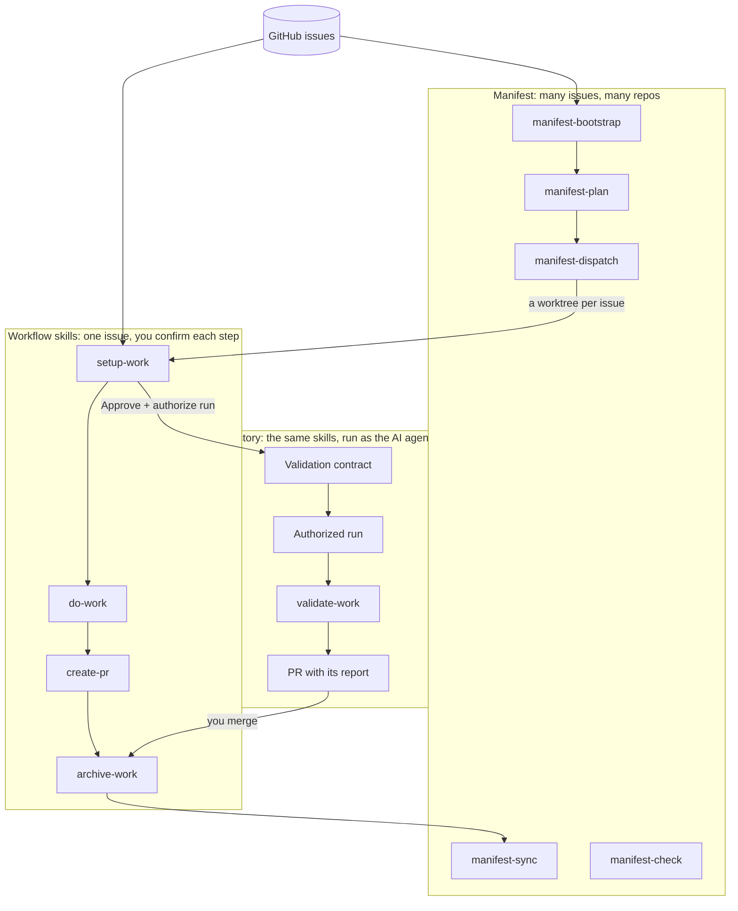
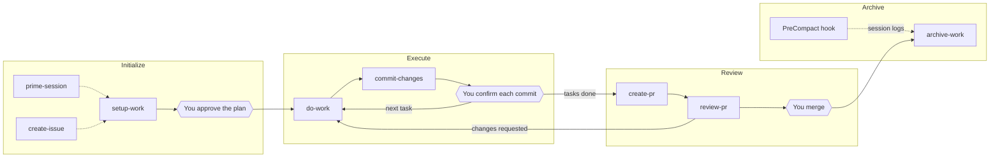
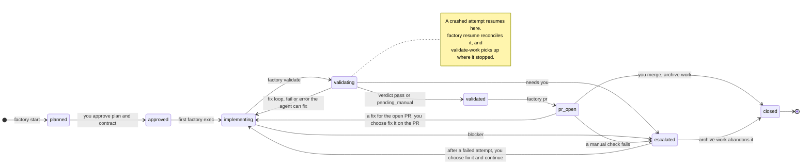
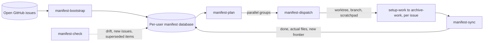

# Escapement

**Claude Code plugin for structured development workflows.** Regulated workflow, one tick at a time.

## What This Is

Escapement takes GitHub issues to merged pull requests in three layers. Each layer builds on the one below it:

| Layer | Scope | Who acts | What it gives you |
|---|---|---|---|
| **Workflow skills** | One issue | Claude, with you confirming each step | Issue → scratchpad plan → atomic commits → PR → archive |
| **Factory** | One issue | The AI agent, under an authorization you grant once | An approved plan and validation contract run to a validated PR. You approve the plan and merge |
| **Manifest** | Many issues, across repos | You, with the skills | A per-user dependency graph: what is ready, what can run in parallel, what drifted |

The workflow skills are the base and need nothing beyond the plugin. The factory and the manifest are two TypeScript CLIs in one package (`scripts/factory.sh`, `scripts/manifest.sh`), sharing a per-user SQLite database. All three work across every project you load the plugin in, and each project tunes them in its own `CLAUDE.md`.



Skills activate from natural language ("setup issue 42", "commit these changes") or explicitly as `/escapement:skill-name`.

## Installation

### From Source

```bash
git clone https://github.com/fusupo/escapement.git

# Run Claude Code with the plugin
claude --plugin-dir /path/to/escapement
```

That is all the workflow skills need. The PreCompact hook also needs `jq`.

### The Factory and the Manifest

The factory runner (`scripts/factory.sh`) and the manifest CLI (`scripts/manifest.sh`) are TypeScript in the plugin's `manifest/` directory. Their dependencies aren't committed, so install them once in the plugin directory, not in your project. This needs Node.js and a C/C++ build toolchain for `better-sqlite3`:

```bash
npm ci --prefix /path/to/escapement/manifest
```

Both wrappers work from any project directory. `bash /path/to/escapement/scripts/factory.sh --check` (or `manifest.sh --check`) reports whether the dependencies are installed.

A factory run also needs the AI agent's identity (see [GitHub as the AI Agent](#github-as-the-ai-agent)), and the project needs its checks in Escapement Settings (see [Escapement Settings](#escapement-settings)).

### From a Marketplace

Escapement isn't published to a plugin marketplace yet. Load it with `--plugin-dir`.

## How It Works

### Layer 1: Workflow Skills

Work moves through four phases. Each one is a skill or two, and each stops for you at the points marked as hexagons:



**Initialize** (`prime-session`, `create-issue`, `setup-work`). `setup-work` fetches the issue and has the `scratchpad-planner` agent analyze the codebase. It then writes `SCRATCHPAD_{issue}.md` with the plan, acceptance criteria, atomic tasks and open questions. It asks you the questions, and creates the feature branch once you approve the plan. `prime-session` orients a new session in the project, and `create-issue` files an issue from a passing idea.

**Execute** (`do-work`, `commit-changes`). `do-work` works through the scratchpad one task at a time and keeps the checklist and work log up to date. `commit-changes` makes an atomic commit in the project's format after each task.

**Review** (`create-pr`, `review-pr`). `create-pr` opens the PR with context from the scratchpad and the commits. `review-pr` reviews it against the project's roadmap. Requested changes go back to `do-work`. You merge.

**Archive** (`archive-work`, hooks). Before Claude Code compacts a session, the PreCompact hook saves the conversation since the last log. After the merge, `archive-work` saves the rest, converts the logs to markdown and moves them with the scratchpad into the archive. With a [context path](#context-path), that is `{context-path}/{branch}/archive/`, listed in `{context-path}/INDEX.md`. It also asks for any non-obvious lessons for the project's `PROJECT_LORE.md`.

### Layer 2: The Factory

The factory lets one approved plan run to a validated PR with no further questions. You approve the plan and merge, and the AI agent does everything in between. It arrived in 4.0.0. Design: [docs/FACTORY_DESIGN.md](docs/FACTORY_DESIGN.md). Runner commands and JSON output: [docs/FACTORY_CLI.md](docs/FACTORY_CLI.md).

1. **Contract.** On a project whose checks are configured, `setup-work` also checks readiness and gathers lore and related archives. It proposes a risk tier (`standard` or `sensitive`) and drafts a **validation contract**: evidence for every acceptance criterion, as a test, a command or a manual check. The contract names no commands. Every check comes from the project's Escapement Settings, so a contract can't skip or narrow them. Before you see the plan, the fresh-context `plan-critic` checks it once (since 4.2.0): does evidence cover every clause of every criterion, would each manual check prove its criterion, is the tier right. The planner answers each finding once, and any finding the two still disagree on is shown to you with both positions, next to the approval question.
2. **Authorization.** At plan approval, **Approve + authorize run** checks out the branch, starts a run and approves the contract. The runner stores the contract and its digest, and issues an authorization. It covers committing, pushing the branch, opening the PR and running validation, never merging, force-pushing or changing the contract. The run gets a deadline (`run-budget`).
3. **Implement.** `do-work` works through the tasks without asking. Builds and tests go through `factory exec`, one at a time across all worktrees, and `commit-changes` commits each task as the agent.
4. **Validate.** `validate-work` runs `factory validate` (the project's `static` and `verify`, whose JUnit results resolve the contract's test evidence). Then the fresh-context `validation-reviewer` judges whether the evidence demonstrates each criterion and signs off sensitive or policy changes. `factory record-review` refuses an incomplete verdict.
5. **PR.** `create-pr` runs `factory pr`, which pushes the branch and opens the PR as the agent, with the validation report in its description. `validate-work` records a manual check later and refreshes the PR's report. Since 4.3.0 it can also carry out a manual check's steps for you in a headless browser and show you what it saw ("run the manual check AC-2.e1"). You still decide the outcome, and the report marks the check agent-assisted. See [Browser for manual checks](#browser-for-manual-checks).
6. **Merge and archive.** You merge. `archive-work` archives the work and closes the run.

The run's states, from `factory.sh status`:



- **Validation preconditions.** If validation can't start (a dirty tree, unusable settings), `factory validate` refuses with `blocked` and changes nothing: the run stays where it is and no attempt is used. The host fixes the cause and validates again, or escalates the run.
- **Fix loop.** When a check fails, or the reviewer blocks the attempt, the run goes back to `implementing` on its own: `do-work` fixes exactly what the report found, commits, and validates a new attempt (since 4.1.0). An error the change caused (a check timed out, the tests wrote into the tree) or the run caused (HEAD moved during validation) loops too. Every attempt counts toward `max-attempts`, and the deadline never moves.
- **Escalation.** The run is `escalated`, and you get a notification with the report, when it needs you: an error from the environment (a check couldn't start, setup failed), `max-attempts` used up, the deadline passed, a sensitive-path sign-off refused or an assertion change the reviewer won't justify, a manual check whose instructions the reviewer rejects (only a new plan can change them, so `do-work` offers abandon or start over), the same check failing the same way twice, or a blocker the agent can't resolve. Any non-terminal state can be escalated, blocked or closed. After a failed attempt, `do-work` offers you **fix it and continue** (the same run, plan and budget, through `factory continue`), **abandon**, or **start over** with `setup-work`. Any other halted run is closed with `archive-work`. Once the PR is open, a fix that belongs on it goes through the same run (#97): a review finding or a change you ask for (`do-work` offers **fix it on the PR**), or a failed manual check (**fix it and continue**). The run gets a new time budget, keeps its approved attempts, and refreshes the same PR; its gate then always says `ping`.
- **Resume.** If the runner or the session dies mid-run, `factory resume` kills orphaned check processes and reconciles the attempt. `do-work` and `validate-work` pick up from `factory authorization`'s `next` step, and a `factory pr` that died finds the PR it already opened instead of opening a second one.
- **Gate.** `gate-mode` is `report-only`: the merge is always yours. Each time `factory pr` opens or refreshes the PR, the gate recommends `auto_merge` only when every rule holds: standard tier, outcome `pass`, no modified assertions or policy changes, the report's head and contract, and the advisory findings, diff size and attempts within the `gate-max-*` limits. Otherwise it recommends `ping`, with one reason per failed rule. The recommendation is recorded on the run, shown in the PR and sent in your notification, whatever it is. When the run is archived, `factory archive --close` records what you did with the PR (`merged_as_is`, `changes_requested`, `rejected` or `abandoned`), so the gate can later be judged against it.

### Layer 3: The Manifest

The manifest plans many issues at once. It is a SQLite dependency graph of open issues: which issues block which, and which files each one is expected to touch. There is one database per user, shared by every project, because work items carry their repo and dependencies cross repos. `scripts/manifest.sh db-path` prints where it is.



1. **`manifest-bootstrap`** builds the graph from open GitHub issues and a codebase analysis.
2. **`manifest-plan`** finds the issues whose dependencies are done and groups those that don't touch the same files.
3. **`manifest-dispatch`** does `setup-work`'s job for a whole group: a worktree, branch, scratchpad and file-ownership constraints per issue. Then it launches an agent for each.
4. **`manifest-sync`** runs after `archive-work`. It marks the item done, records the archive path and the files actually changed, and recomputes what is ready next.
5. **`manifest-check`** catches drift at any time: new issues, superseded items, wrong file predictions.

`setup-work` mirrors its readiness check into an issue's work item, so an issue with open questions leaves the frontier until they're answered. Design: [docs/MANIFEST_SYSTEM_DESIGN_V2.md](docs/MANIFEST_SYSTEM_DESIGN_V2.md).

### Browser for manual checks

The plugin bundles Microsoft's Playwright MCP server, so every session that loads Escapement has browser tools (#103). `validate-work` uses them to carry out a factory run's manual checks for you. Its config, in `.claude-plugin/plugin.json`:

- **Pinned:** `@playwright/mcp@0.0.84`, through `npx`.
- **Its own browser:** Playwright's Chromium (`--browser chromium`, the `chrome-for-testing` build), not your installed Chrome. Install it once:
  ```bash
  npx -y @playwright/mcp@0.0.84 install-browser chrome-for-testing
  ```
  Without it, the browser tools fail with an error that the browser is not installed, and `validate-work` stops the check and names this command.
- **Headless.** Set `ESCAPEMENT_BROWSER_HEADLESS=false` before starting Claude Code to watch the browser in a window. Only `true`, `false`, `1` and `0` are understood.
- **Local only.** Only `http://localhost:*` and `http://127.0.0.1:*` may be requested. This keeps manual checks on your dev server, but it is a guard rail, not a security boundary: Playwright's own docs say so, and it doesn't affect redirects.
- **No files in your worktree.** Screenshots and page snapshots go to `$TMPDIR/escapement-playwright` (or `/tmp/escapement-playwright`), with an in-memory browser profile. `validate-work` copies the screenshots it keeps into the run's artifact dir.

### Browser tests as evidence

For a web app, a factory plan can check UI behavior with browser tests instead of manual checks. A browser test (Playwright Test) drives the page and checks what it shows and the files the app writes. It is ordinary `test` evidence: it runs on every attempt, the reviewer sees its result, and the fix loop can act on its failure. A manual check runs once, by a person, after the PR is open (#104).

The runner needs nothing new: the project's `verify` runs the unit tests and then the browser tests, both write JUnit into `$FACTORY_RESULTS_DIR`, and `test-results` points at that folder. Pin Playwright Test, use one worker and no retries, start a dev server per run on temporary data, and put `playwright.config.ts` at the repository root with `testDir` set on its project, so that selectors such as `e2e/graph.spec.ts::Graph › adds a node` resolve. Then set `browser-tests: playwright`: `factory check` reports it, `setup-work`'s planner writes UI criteria as browser-test evidence, and the plan critic flags a manual check that could have been a browser test. The full setup: [Browser tests as evidence](docs/FACTORY_CLI.md#browser-tests-as-evidence). Its worked example is fusupo/hackensack-next, a Vite and React editor whose config and settings are quoted there unchanged: [Worked example: hackensack-next](docs/FACTORY_CLI.md#worked-example-hackensack-next).

### GitHub as the AI Agent

Escapement keeps its automated work visibly separate from yours: on GitHub, it acts as an AI agent account.

- **Issues, PRs, comments and reviews** go through the GitHub MCP tools, so connect the GitHub MCP server with the agent account's credentials. Skills never use the `gh` CLI, which is logged in as you.
- **Pushes** go through `factory push`, with the agent's token, which is only ever sent to github.com. In a project hosted elsewhere, pushes stay yours.
- **Commits** carry the agent's name and email (`factory agent`).

Configure the agent identity once, in `~/.config/escapement/agent.env` (`chmod 600`), or export the variables:

```
ESCAPEMENT_AGENT_GH_TOKEN=ghp_…              # the agent account's token
ESCAPEMENT_AGENT_NAME=Escapement Agent       # optional commit name
ESCAPEMENT_AGENT_EMAIL=agent@example.com     # optional commit email
```

Without it, `commit-changes` and `create-pr` commit and push as you and say so. An authorized factory run requires it and never falls back to you. See [FACTORY_CLI.md](docs/FACTORY_CLI.md#github-and-the-agent-identity).

## Skills

Skills are invoked automatically by Claude Code when relevant, or explicitly with the `/escapement:` prefix:

```bash
# Natural language
"Setup GitHub issue #42"
"Commit these changes"
"Create a PR for this branch"

# Explicit
/escapement:setup-work
/escapement:commit-changes
/escapement:create-pr
```

| Skill            | Triggers                            | Purpose                                        |
| ---------------- | ----------------------------------- | ---------------------------------------------- |
| `setup-work`     | "setup issue #X", "start issue #X"  | Fetch issue, create scratchpad, prepare branch; on projects set up for the factory, also draft a validation contract and offer to authorize a run |
| `commit-changes` | "commit", "commit these changes"    | Smart commits with conventional format, as the AI agent when one is configured; under an authorized factory run, without asking |
| `create-pr`      | "create a PR", "open pull request"  | Context-aware PR creation as the AI agent (`factory push`, GitHub MCP tools); under an authorized run, through `factory pr` with the validation report |
| `review-pr`      | "review PR #X", "check this PR"     | Roadmap-aware code review                      |
| `do-work`        | "start working", "continue work"    | Execute tasks from scratchpad; under an authorized run, from approved plan to open PR with no questions |
| `validate-work`  | "validate this work", "run the manual check AC-2.e1", "record the manual check" | Validate a factory run: checks, fresh-context reviewer, recorded verdict; carry out a manual check in a browser for you; manual outcomes |
| `archive-work`   | "archive this work", "clean up"     | Move completed scratchpads to archive; archive and close a factory run |
| `create-issue`   | "create an issue", "file a bug"     | Ad hoc GitHub issue creation from natural language |
| `stash-artifact` | "stash this script", "save to context" | Save artifacts to context directory         |
| `prime-session`  | "orient me", "what is this project" | Read project docs for context                  |
| `manifest-bootstrap` | "bootstrap the manifest"       | Build manifest dependency graph from GitHub issues |
| `manifest-plan`  | "plan the dispatch"             | Generate dispatch plan with parallel groups and overlaps |
| `manifest-sync`  | "sync the manifest", "mark work done" | Mark items done, record actuals, recompute frontier |
| `manifest-check` | "check manifest health"         | Detect stale items, reconcile predictions, find drift |
| `manifest-dispatch` | "dispatch work"              | Create worktrees, constraint blocks, launch parallel agents |

## Hooks

**PreCompact hook** (`archive-session-log.sh`). Before Claude Code compacts a session, automatically or manually, the hook saves the raw transcript. It writes only the conversation since the previous log, to `SESSION_LOG_{N}.jsonl` in the **project root**, so a long session spanning many issues doesn't repeat itself in every log. `archive-work` later saves the session's tail since the last log, converts the `.jsonl` files to markdown (`scripts/convert-session-log.py`) and moves them to the archive. See [Session Archiving](docs/SESSION-ARCHIVING.md#what-a-session-log-covers) for exactly what each log covers. It needs `jq`.

Only the session that runs `archive-work` gets its tail saved. Another session's conversation is kept only up to its last compaction.

**PreToolUse hook** (`factory-exec-guard.sh`). It keeps a factory run's builds and tests on the shared build lock. It acts only in a worktree whose run is being implemented under an authorization (a marker the runner keeps inside `.git`), and refuses the project's `static` and `verify` commands unless they go through `factory exec`. Everywhere else it exits at once. A project opts out with `exec-hook: off`. See [FACTORY_CLI.md](docs/FACTORY_CLI.md#the-exec-guard).

## Agents

### scratchpad-planner

Invoked by `setup-work` to analyze the codebase and plan the work. It reads the project's `CLAUDE.md`, finds the affected modules and similar code, and breaks the issue into atomic tasks. It also raises the questions the issue leaves open. On the factory path it also proposes the risk tier, the predicted files and evidence for every acceptance criterion.

### validation-reviewer

A fresh-context reviewer for a factory attempt awaiting review. Given the `bundle.json` that `factory.sh review-input` writes, it does three things:
- judges whether each piece of evidence demonstrates its criterion;
- signs off sensitive and execution-policy changes;
- justifies modified assertions.

It writes a verdict file and never edits code. `validate-work` records the verdict with `factory.sh record-review`, which rejects an incomplete one.

The agent is a thin wrapper: the reviewer's instructions are `prompts/factory/validation-reviewer.md`, runtime-neutral data that any host can run (`factory.sh prompt reviewer`).

### plan-critic

A fresh-context critic for a factory plan, before you approve it. `setup-work` gives it a `brief.json`: the issue, the scratchpad, the draft validation contract, `factory.sh check`'s readiness, lore and related archives, and the repository. It never sees the planner's reasoning. It judges eleven checklist items, among them whether evidence covers every clause of each criterion, whether each manual procedure would prove its criterion, and, in a project with browser tests, whether a manual check could be a browser test, and writes a critique with a verdict (`approve`, `revise` or `escalate`), severity-rated findings and an optional tier raise. `factory.sh check-critique` checks it against `schemas/factory/critique.schema.json`, and `factory.sh record-critique` records each finding's disposition on the run.

Like the reviewer, the agent is a thin wrapper over `prompts/factory/plan-critic.md` (`factory.sh prompt critic`).

## Escapement Settings

A project configures Escapement in a `## Escapement Settings` section of its `CLAUDE.md`. Only the first such section is read, and fenced code blocks are ignored, so examples like the ones below never match. Every key is optional.

```markdown
## Escapement Settings

- **context-path**: ../myproject-ctx
- **base-branch**: develop
- **static**: npm run lint && npx tsc --noEmit
- **verify**: npm test -- --reporter=junit --output=$FACTORY_RESULTS_DIR/junit.xml
- **test-results**: junit:$FACTORY_RESULTS_DIR/junit.xml
- **sensitive-paths**: src/auth/**, migrations/**
```

| Key | What it sets | Default |
|---|---|---|
| `context-path` | Where archives, stashed artifacts and run artifacts go, outside the repo ([below](#context-path)) | none (in the repo) |
| `base-branch` | The branch a factory run targets | `develop` if `origin/develop` exists, else `main` |
| `setup`, `static`, `verify` | The project's check commands. A project is set up for the factory once its required checks are set | none |
| `required-checks` | Which of `setup`, `static`, `verify` validation requires | `static, verify` |
| `test-results` | Where `verify` writes JUnit, as `junit:{path}`, usually under `$FACTORY_RESULTS_DIR` | none |
| `test-files` | Globs naming test files, for change classification | common test patterns |
| `sensitive-paths` | Globs whose change makes a run `sensitive` | none |
| `validation-files` | Globs of execution policy (test config, CI, scripts); a change makes a run `sensitive` | none |
| `max-attempts` | Validation attempts per run | `3` |
| `command-timeout`, `lock-timeout`, `run-budget` | Per-command timeout, lock wait, and the run's deadline from approval | `15m`, `30m`, `2h` |
| `exec-hook` | The exec guard during runs (`on`, `off`) | `on` |
| `gate-mode` | How the gate acts on a report | `report-only` |
| `gate-max-diff-lines` | The gate recommends auto-merge only for a diff of at most this many lines (added plus removed) | `400` |
| `gate-max-diff-files` | The gate recommends auto-merge only for a diff of at most this many files | `15` |
| `gate-max-advisories` | The gate recommends auto-merge only with at most this many advisory findings | `0` |
| `gate-max-attempts` | The gate recommends auto-merge only for a run that passed within this many attempts | `1` |
| `browser-tests` | The project's browser test tool (`playwright`), so planning writes UI criteria as browser-test evidence. See [Browser tests as evidence](docs/FACTORY_CLI.md#browser-tests-as-evidence) | none |

The factory keys are read by the runner, which applies the same section and fence rules. See [FACTORY_CLI.md Settings](docs/FACTORY_CLI.md#settings) for value formats and glob rules. Escapement's own settings, at the end of its [CLAUDE.md](CLAUDE.md), make it a factory project too.

### Context Path

By default, development artifacts (session logs, archives) live inside your code repo. For larger projects this causes search pollution, repo bloat and noisy diffs. `context-path` redirects them to a directory outside the repo, usually a sibling:

- **`archive-work`** archives scratchpads and session logs to `{context-path}/{branch}/archive/` instead of `docs/dev/cc-archive/`, and keeps `{context-path}/INDEX.md`, a chronological table of all archived work across branches.
- **`stash-artifact`** saves ad hoc scripts and notes to `{context-path}/{branch}/scripts/` or `{context-path}/{branch}/notes/`.
- **Factory runs** keep their contract, logs, reports and verdicts in `{context-path}/{branch}/runs/{run_id}/`, read from the main checkout's `CLAUDE.md`.
- **`setup-work`** reads `{context-path}/PROJECT_LORE.md` and related archives as context.

The PreCompact hook always writes `SESSION_LOG_{N}.jsonl` to the project root, alongside the scratchpad, and `archive-work` moves the logs at archive time. The manifest database is never under context-path (see [Layer 3](#layer-3-the-manifest)).

The context directory is plain markdown that can be git-tracked and works well with tools like Obsidian. See [docs/CONTEXT_PATH.md](docs/CONTEXT_PATH.md) for the full design.

## Per-Project Customization

Escapement is installed **once** as a plugin and works across **all your projects**. Skills detect the current repo and read its `CLAUDE.md` for project modules, commit format, branch naming and Escapement Settings:

```markdown
# In your-project/CLAUDE.md

## Project Modules

- **api** 🔌: REST API endpoints
- **frontend** 🎨: React UI components

## Commit Message Format

{module emoji}{change type emoji} {type}({scope}): {description}
```

See [docs/CUSTOMIZATION.md](docs/CUSTOMIZATION.md) for detailed examples and patterns, and [docs/WORKFLOW.md](docs/WORKFLOW.md) for a longer walk through the workflow skills.

## Structure

```
escapement/
├── .claude-plugin/
│   └── plugin.json           # Plugin manifest, and the bundled Playwright MCP server
├── skills/                   # One directory per skill (see Skills)
├── hooks/
│   ├── hooks.json            # Hook configuration
│   ├── archive-session-log.sh # PreCompact hook (JSONL slice)
│   └── factory-exec-guard.sh  # PreToolUse hook: a run's checks go through factory exec
├── manifest/                 # Manifest and factory CLIs (TypeScript, SQLite)
│   ├── manifest-cli.ts       # Manifest entry point; run it through scripts/manifest.sh
│   ├── factory-cli.ts        # Factory runner entry point; run it through scripts/factory.sh
│   ├── factory/              # Runs, locks, exec, resume, settings, tiers, schemas, readiness, validate, review, authorization, GitHub, pr, manual, archive, guard
│   ├── init.ts               # Database setup and context-path resolution
│   ├── plan.ts               # Dispatch plan generation
│   ├── migrations.ts         # Ordered schema migrations (PRAGMA user_version)
│   ├── schema.sql            # Migration 1: work items and edges
│   ├── migrations/           # Later migrations (002: factory tables)
│   ├── queries/              # SQL for frontier, overlap, reconcile, etc.
│   ├── run-suites.ts         # Runs every suite one at a time, writes JUnit
│   └── test-*.ts             # Test suites
├── scripts/
│   ├── run-tests.sh           # Runs every test suite (Escapement's own verify)
│   ├── convert-session-log.py # JSONL→markdown session log converter
│   ├── get-context-path.sh    # Shared context-path parser for skills
│   ├── manifest.sh            # Runs the manifest CLI from any project directory
│   ├── factory.sh             # Runs the factory CLI from any project directory
│   ├── migrate-archives.py    # Migrate in-repo archives to context-path
│   ├── slice-session-log.sh   # Transcript slicing with a per-session cursor
│   ├── test-*.sh, test-*.py   # Shell and Python test suites
│   └── fixtures/              # Test fixtures
├── schemas/factory/          # Published JSON Schemas: contract, report, verdict, readiness, critique
├── prompts/factory/          # Agent prompts the factory ships as data (validation-reviewer, plan-critic)
├── agents/                   # Specialized subagents
│   ├── scratchpad-planner.md # Codebase analysis for setup-work
│   ├── plan-critic.md        # Claude Code wrapper for the factory plan critic prompt
│   └── validation-reviewer.md # Claude Code wrapper for the factory reviewer prompt
├── docs/                     # Extended documentation
│   ├── WORKFLOW.md           # Workflow explanation
│   ├── CUSTOMIZATION.md      # How to customize
│   ├── CONTEXT_PATH.md       # Context path design and usage
│   ├── SESSION-ARCHIVING.md  # What session logs cover and how they're archived
│   ├── MANIFEST_SYSTEM_DESIGN_V2.md # Manifest design (current)
│   ├── MANIFEST_SYSTEM_DESIGN.md    # Manifest design (original, superseded by V2)
│   ├── FACTORY_DESIGN.md     # Factory design: contract-driven validation
│   ├── FACTORY_CLI.md        # Factory runner commands, JSON output, exit codes
│   └── CODEX-PORT.md         # Plan for a Codex CLI port
└── README.md                 # This file
```

## Development

### Running the Tests

```bash
npm ci --prefix manifest                          # once per checkout or worktree
bash scripts/run-tests.sh                         # every suite, one at a time
bash scripts/run-tests.sh manifest/test-readme.ts # one suite
```

Never run suites in parallel. `manifest/test-readme.ts` keeps this README honest: every skill listed, no retired names, no broken links, the four diagrams, no leftover images.

### Running the Factory on Escapement

Escapement is a factory project itself. A run on Escapement loads the plugin from a pinned checkout, never from the checkout being changed, so the run's own edits to skills or the runner can't change them mid-run:

```bash
git worktree add --detach ../escapement-plugin develop
claude --plugin-dir ../escapement-plugin
```

### Adding a New Skill

1. Create directory: `skills/your-skill-name/`
2. Create `SKILL.md` with frontmatter:
   ```markdown
   ---
   name: your-skill-name
   description: What this skill does. Invoke when user says "trigger phrase".
   tools:
     - mcp__github__*
     - Read
     - Write
   ---
   ```
3. If the skill runs a plugin script, call it through the plugin root, e.g. `bash "${CLAUDE_PLUGIN_ROOT}/scripts/get-context-path.sh"`, and add `Bash:bash *` to `tools`. Paths like `scripts/...` or `manifest/...` resolve against the user's project, not the plugin
4. For anything on GitHub, use the GitHub MCP tools, never `gh`. `manifest/test-skills-github.ts` enforces this
5. List the skill in this README's Skills table (`manifest/test-readme.ts` checks)
6. Test: `claude --plugin-dir /path/to/escapement`

### Adding a New Agent

1. Create `agents/your-agent.md`
2. Define specialized expertise
3. List required tools in frontmatter
4. Test: `claude --plugin-dir /path/to/escapement`

### Adding Hooks

Edit `hooks/hooks.json` following the [Claude Code hooks documentation](https://code.claude.com/docs/en/hooks). Use `${CLAUDE_PLUGIN_ROOT}` for paths.

## Troubleshooting

### Plugin not loading, or skills not appearing

```bash
# The manifest must be valid JSON
jq . /path/to/escapement/.claude-plugin/plugin.json

# Each skill is a directory with a SKILL.md
ls /path/to/escapement/skills/

# Restart Claude Code with the plugin
claude --plugin-dir /path/to/escapement
```

Skills are loaded once per session, so a SKILL.md edited or merged mid-session takes effect in the next session.

### Factory or manifest skills fail with `Cannot find package 'tsx'` or `dependencies are not installed`

```bash
# Install the CLIs' dependencies in the plugin, not in your project
npm ci --prefix /path/to/escapement/manifest

# Both should exit 0
bash /path/to/escapement/scripts/factory.sh --check
bash /path/to/escapement/scripts/manifest.sh --check
```

### setup-work doesn't offer "Approve + authorize run"

The project isn't set up for the factory, or readiness has open questions. Run `bash /path/to/escapement/scripts/factory.sh --json check` in the project. `needs_human` lists what's missing, usually a `static` or `verify` command in Escapement Settings. Answer the open questions, or approve the plan plainly.

### A factory run stops with `no_agent_token` or `agent_env_permissions`

The run acts as the AI agent and never falls back to you. Put `ESCAPEMENT_AGENT_GH_TOKEN` in `~/.config/escapement/agent.env` and `chmod 600` it, or export it. Then check it with `factory.sh --json agent` and re-enter `do-work`.

### Validation is blocked with `dirty_tree`

Validation needs a clean tree. Commit work that belongs to the run, and list working files such as scratchpads in `.git/info/exclude` with `factory.sh exclude 'SCRATCHPAD_*'`. A blocked validation uses no attempt.

### The exec guard refuses a check command

During a run, the project's `static` and `verify` go through `factory exec '{run_id}' -- {command}`, which the refusal prints in full. Quote the run ID, because it contains `#`. A project that doesn't want the guard sets `exec-hook: off`.

### Hooks not working

```bash
# jq is required
which jq

# hooks.json must be valid JSON, and the scripts executable
jq . /path/to/escapement/hooks/hooks.json
ls -la /path/to/escapement/hooks/
```

## Contributing

Contributions welcome! To contribute:

1. Fork or clone this repo
2. Create a feature branch from `develop`
3. Add/modify skills, hooks, or agents
4. Run `bash scripts/run-tests.sh`, and test with `claude --plugin-dir /path/to/escapement`
5. Submit a PR against `develop` with a description of the changes

## License

MIT

## Maintainer

fusupo

## Version

**Current:** 4.6.0

**Changelog:**
- 4.6.0 (2026-11-19): Re-entry after the PR is open (#97)
  - **`factory continue` takes a run with a PR back.** A `pr_open` run goes back to implementing on your request, with `--trigger review_finding` or `operator_request` (the default). An escalated run with a PR, after a failed manual check or a failed attempt, goes back too, its trigger worked out by the runner (`manual_check_failed`, `attempt_failed`). Same contract and authorization; the fix lands on the same PR
  - **A new deadline.** Review and manual checks usually come after the deadline, so a re-entry sets now plus the budget fixed at approval (or `--run-budget`), never the branch's setting. The attempt budget isn't reset
  - **Recorded.** Each re-entry is a `state_change` event (`entity: "reentry"`) with the trigger, the reason, the attempt and head it left from and the gate's recommendation then. No migration
  - **Gate and metrics.** A new gate rule, `reentry`, gives `ping` for a re-entered run; `archive --close` records a re-entered run that merged as `changes_requested`, so §7.4's false auto-merge rate counts it
  - **Handoff and PR.** `factory authorization` gives `fix.trigger` and `fix.reason`, and a `reentry` summary. The refreshed PR lists the manual checks to do again on the new head. New fault point `pr.updated`, with crash tests at it and at `continue.committed` for both ways back
  - **Skills.** `do-work` 1.6.0 offers it (an escalated run with a PR, and **Back to an open PR**, matched or past its deadline), `create-pr` 1.5.0 rewrites the narrative on that refresh, and `validate-work` 1.5.0 points a failed manual check at it
- 4.5.0 (2026-11-18): The gate in report-only mode (#110)
  - **Recommendation.** `factory pr` works out a recommendation for the report the PR shows. `auto_merge` needs every rule to hold: actual tier `standard`, outcome `pass`, no modified assertions, no execution-policy changes, the report's head and contract, and the advisory findings, diff lines, diff files and attempts within their limits. Otherwise it is `ping`, with one reason per failed rule. It is recorded on the run (`gate_recommendation`, `gate_reasons_json`) and as a `gate` event before the PR shows it. It is returned as `.result.gate`, and the PR's report section shows it. Nothing is ever merged
  - **Limits.** Four new settings: `gate-max-diff-lines` (400), `gate-max-diff-files` (15), `gate-max-advisories` (0) and `gate-max-attempts` (1). A branch that loosens them is an execution-policy change, so its gate says `ping`
  - **Refreshes.** Each refresh works the gate out again. Once the manual checks resolve to `pass`, an earlier `ping` can become `auto_merge`, and the earlier one stays in the run's events. An unchanged result adds no event. A crash between recording the gate and the PR (fault point `pr.gate_recorded`) is repaired by running `pr` again
  - **What you did.** `factory archive --close` records `merged_as_is`, `changes_requested`, `rejected` or `abandoned` in the run's `operator_action`, and as an `operator_action` event, next to the gate's recommendation. `.result.closed` is unchanged. [FACTORY_CLI.md](docs/FACTORY_CLI.md#archive) lists what it can't see
  - **Skills.** `do-work` 1.5.0, `create-pr` 1.4.0 and `validate-work` 1.4.0 report the gate and notify you whatever it recommends. `archive-work` 2.6.0 reports the operator action
- 4.4.2 (2026-11-18): archive-work copies a run's plan critique (#101)
  - **Fix.** Since #99, `factory record-critique` writes the plan critique to the run's `critique.json`, but `archive-work` left it out of the archive. Phase 6.5 now copies it into `archive/runs/{run_id}/` when the run has one (`archive-work` 2.5.2). [docs/CONTEXT_PATH.md](docs/CONTEXT_PATH.md) lists what an archived run holds, the manual-check attachments from #103 included
- 4.4.1 (2026-11-18): One readiness document for the plan critic (#109)
  - **Fix.** On the factory path, `setup-work` wrote the manifest's cut-down readiness copy and the critic's full `factory check` result to the same file, so the critic could lose `browser_tests`, `tier` and `required_checks`. Now one document, check's full result plus setup-work's still-open questions, is brought up to date after the Q&A, mirrored into the manifest and given to the critic (`setup-work` 1.4.1)
- 4.4.0 (2026-11-18): Browser tests as contract evidence (#104)
  - **`browser-tests` setting.** A project whose `verify` runs browser tests says so with `browser-tests: playwright`. `factory.sh check` reports it as `browser_tests` (in the published readiness schema, and as a `browser tests:` line in its text); the runner does nothing else with it
  - **Planning.** On the factory path, `setup-work` hands the setting to the `scratchpad-planner`, which writes UI criteria as browser-test evidence (`e2e/file.spec.ts::Describe › title`, repository-relative) and keeps `manual` for what a machine can't judge, such as a subjective visual or reading prose
  - **Plan critic.** An eleventh checklist item, `manual_could_be_browser_test`, flags a manual check that could have been a browser test. It is a new required value in the published critique schema; without browser tests the critic judges it `ok`
  - **Setup docs.** [Browser tests as evidence](docs/FACTORY_CLI.md#browser-tests-as-evidence): Playwright Test pinned, one worker, no retries (a retried pass is invisible in Playwright's JUnit), one project, a per-run dev server on temporary data, JUnit into `$FACTORY_RESULTS_DIR` with `outputDir` outside it, and the rootDir rule: put `playwright.config.ts` at the repository root and set `testDir` on its project, or selectors are `not_found`. fusupo/hackensack-next is the worked example, quoted unchanged
  - **Pinned shapes.** `manifest/test-factory-junit.ts` resolves selectors against JUnit captured from a real Playwright Test 1.64.1 run
- 4.3.0 (2026-11-17): Agent-assisted manual checks in a real browser (#103)
  - **Bundled browser.** The plugin ships Microsoft's Playwright MCP server (`@playwright/mcp@0.0.84`, in `plugin.json`): Playwright's own Chromium, headless unless `ESCAPEMENT_BROWSER_HEADLESS=false`, an in-memory profile, output outside the worktree, and only `localhost` and `127.0.0.1` origins (a guard rail, not a security boundary). Install the browser once with `npx -y @playwright/mcp@0.0.84 install-browser chrome-for-testing`
  - **`validate-work` carries out a manual check** on request ("run the manual check AC-2.e1"). It reads the instructions from the run's contract, does the setup they name, carries out each step in the browser or the shell, reports what it saw at each "Check:", and saves screenshots and observations under `{artifact_dir}/manual/{evidence_id}/`. It hands back steps it can't do, stops background processes, and asks you for the outcome. It never decides it. Manual checks no longer need a matched authorization, so they work past the run's deadline
  - **`factory.sh record-manual --assisted --attachment <file>`** records your outcome as agent-assisted, with the agent's files. The report's `manual_outcomes` gain optional `assisted` and `attachments` (still version 1), and the PR's report section marks the check agent-assisted
  - **One check at a time.** Outcomes recorded while other checks are still pending are listed by `record-manual` and `factory.sh status`, and shown in the PR's report section after `factory pr`
  - **`archive-work`** copies the attachments into the run's archive
- 4.2.0 (2026-11-17): Plan critique before approval, and a rejected manual procedure escalates at once (#99)
  - **Plan critique.** On the factory path, `setup-work` has the new `plan-critic` agent, with fresh context, critique the plan and its validation contract once before you approve it. Its checklist covers evidence for every clause of each criterion, manual procedures that would prove their criterion, new-behavior tests that would fail without the change, predicted files, a simpler approach, lore conflicts, coupling with other work, the tier and the issue's size. The planner answers each finding once; a blocking or major finding it rejects is shown to you with both positions before the approval question. A tier raise is applied
  - **Recorded.** The scratchpad's `## Plan Critique` lists every finding and what became of it: accepted with the plan change it caused, or rejected and why. On "Approve + authorize run", **`factory.sh record-critique`** writes it to the run as `critique.json` and one `critique_finding` event per finding
  - **`factory.sh check-critique`** checks a critique against the new published `critique.schema.json` and its rules, with no run or database; `factory.sh prompt critic` finds the critic's prompt
  - **A rejected manual procedure escalates at once.** A reviewer's `judgment:` finding now carries the judged item's `evidence_type`. When the reviewer rejects a manual check's instructions, the run escalates with attempts to spare instead of looping until `max-attempts`: the instructions are in the approved contract, so only a new plan can change them, and `do-work` offers abandon or start over. A test or command judged `no` or `partial` still loops
- 4.1.0 (2026-11-17): The factory's bounded fix loop: a failed validation no longer ends the run (#92)
  - **Fix loop.** After a `fail`, or an `error` the change or the run caused, the runner sends the run back to `implementing` while `max-attempts` has room, and `do-work` fixes the report's blocking findings and validates a new attempt. It escalates instead on an environment error, a used-up budget or deadline, a finding that needs your judgment (a refused sign-off, an unjustified assertion), or a check failing the same way twice (stuck). One decision in the runner (`manifest/factory/fixloop.ts`) is applied by validate, record-review and resume alike, so a crash resolves as the crashed command would have
  - **`factory continue`.** An escalated run whose latest attempt failed or errored goes back to `implementing` under the same contract and authorization, with the deadline and budget kept. A run whose PR is open couldn't go back yet (since 4.6.0 it can, #97). `do-work` offers it in plain words: fix it and continue, abandon, or start over
  - **Budget fixed at approval.** Like the deadline, `max-attempts` is recorded when the run is first approved, so a commit to the branch's settings can't raise it
  - **Error causes.** Every `error` attempt records who can fix it, `code`, `run` or `environment`, in its report (`error`) and on the attempt (schema migration 3), a runner error during validation included. `factory authorization` hands the implementer the last attempt's blocking findings and error (`fix`)
  - **Reports.** Evidence that passed in an earlier attempt and fails now is flagged as a regression, and the PR's report lists every attempt with its outcome
  - **Crash tests.** `scripts/test-factory.sh` kills the runner at each fix-loop boundary, with the new fault points `record-review.committed` and `continue.committed`
- 4.0.0 (2026-11-16): The factory's first release is complete, and Escapement acts on GitHub as the AI agent (#65, #80)
  - **Factory first release.** An issue goes from `setup-work` to a PR with a validation report, and the operator touches only plan approval and merge. Interrupted runs resume correctly. The acceptance test (#65) ran a real Escapement issue end to end with every crash boundary interrupted; the findings are fixed below
  - **Behaviour change: skills act on GitHub as the agent (#80).** When an agent identity is configured (`ESCAPEMENT_AGENT_GH_TOKEN` in `~/.config/escapement/agent.env`, or exported), plain `commit-changes` commits with the agent's name and email, and plain `create-pr` pushes with the agent's token. Before, they used your own git identity and credentials. Without an agent identity, or off github.com, they fall back to yours and say so
  - **Skills use the GitHub MCP tools only (#80).** No skill calls the `gh` CLI any more, which is logged in as you. create-pr, manifest-sync, validate-work, create-issue, review-pr, setup-work and manifest-dispatch use the MCP server's current tools. `manifest/test-skills-github.ts` keeps it that way
  - **New `factory.sh push` (#80)** pushes the current branch as the agent, outside a run. It's never forced, and it never pushes the base branch, origin's default branch, `main` or `master`. It sets the branch's upstream
  - **The agent token goes to github.com only (#80).** `factory push` and the run's own push refuse any other origin host (`not_github`) before the token is used
  - **`factory pr` updates PRs through the REST API (#65).** `gh pr edit` fails in repositories where classic Projects are deprecated, so a PR created before a crash couldn't be recorded, and a PR couldn't be refreshed after a manual check
  - **`factory check` works on a detached HEAD (#65)**, so setup-work offers a factory run in a `git worktree add --detach` worktree
  - **The PR's report section escapes `<` and `>` (#65)**, so GitHub no longer drops text such as an email address in a manual note
- 3.13.0 (2026-11-16): Crash recovery for the factory, and Escapement as a factory project (#65)
  - **Crash tests:** `ESCAPEMENT_FACTORY_FAULT` (testing only) makes the runner die at a named point: during checks, after checks, after the review is issued, while the review is recorded, after the PR is created. `scripts/test-factory.sh` crashes it at each one and checks that the run resumes
  - **A crashed check no longer keeps running:** its process group is killed by `factory resume`, or by the next command that takes over the dead runner's lock
  - **Resuming after a crash:** `factory authorization` says `validate` after an interrupted attempt and `resume` for one left mid-way; `validate-work`, `do-work` and `create-pr` resume on their own when the runner dies without output
  - **`scripts/run-tests.sh`** runs all of Escapement's suites one at a time and writes JUnit XML, so a contract can name one assertion
  - **Escapement is a factory project:** its own Escapement Settings set `static`, `verify` and the factory's paths, so setup-work offers "Approve + authorize run" for Escapement issues
- 3.12.0 (2026-11-16): The factory's authorized path (#64)
  - **From approved plan to open PR with no questions.** When `setup-work`'s "Approve + authorize run" authorized a run, `do-work` works through the tasks with builds and tests through `factory exec`, commits each one, validates and opens the PR. When something stops it, it escalates the run, notifies you and stops. Your touches are plan approval and merge. Without an authorization every skill behaves as before
  - **The AI agent's identity on GitHub.** Under an authorization, commits carry the agent's name and email, and the push and PR run as the agent's GitHub account: put `ESCAPEMENT_AGENT_GH_TOKEN` (optionally `ESCAPEMENT_AGENT_NAME`, `ESCAPEMENT_AGENT_EMAIL`) in `~/.config/escapement/agent.env` (`chmod 600`), or export it. Without it the factory refuses rather than acting as you
  - **`factory.sh pr`** pushes the run's branch and opens or updates its PR in one locked step, with the validation report in the description. Running it again after a crash finds the PR instead of opening a second one
  - **New `validate-work` skill:** `factory validate`, then the fresh-context reviewer, then `factory record-review`, with up to two re-runs of an incomplete verdict. It also records manual checks
  - **`factory.sh record-manual`** records a human's outcome for manual evidence; when they resolve, the report gets a new revision and a failure escalates the run
  - **`factory.sh authorization`**, **`agent`**, **`escalate`** and **`archive`**: the run a worktree's skills may act for, the agent's commit identity, stopping a run for a human, and archiving and closing a run (`archive-work` now does this)
  - **Exec guard:** a PreToolUse hook refuses a run's `static` and `verify` commands outside `factory exec` while the run is implemented; `exec-hook` now defaults to `on`
- 3.11.0 (2026-11-16): setup-work produces the validation contract and run authorization (#63)
  - **Factory path in `setup-work`**, only for projects whose required checks are configured (otherwise it is unchanged): a readiness check before planning, relevant lore and related archives, a proposed risk tier, and a validation contract with evidence for every criterion, checked with `factory check` and written into the scratchpad
  - **"Approve + authorize run"** next to plain "Approve" at plan approval. It checks out the branch, excludes the working files, starts a factory run, writes the contract into it and approves it, then confirms the authorization's digest matches the stored contract. Plain approval creates no run
  - **`factory.sh exclude <pattern>…`** adds a host's working-file patterns to the repository's `.git/info/exclude`, once each
  - **`factory.sh check`** without `--contract` checks only the project's settings, so a host can tell whether a project is set up for the factory before planning. It also reports `target_ref`, the branch a run targets by default
  - **`factory.sh start`** refuses to start a run on its target branch (`on_target_branch`)
  - **`manifest.sh readiness <owner/repo> <issue> <file|->`** mirrors a readiness check into the issue's work item: `needs_human` takes it off the frontier until the questions are answered
- 3.10.0 (2026-11-16): Factory reviewer with runner-enforced completeness (#62)
  - **`factory.sh review-input <run_id> <attempt>`** writes the reviewer's bundle. It holds the issue text the host passes with `--issue-file`, the approved contract, the exact diff, the draft report, every log and results path, a read-only snapshot of the validated revision with its digest, and the list of judgments a complete verdict needs
  - **`factory.sh record-review <run_id> <attempt> <file>`** rejects a verdict that misses or repeats an evidence judgment, a sensitive or policy sign-off or a justification, or names the wrong snapshot. A rejected verdict changes nothing. An accepted one finalizes the report: `fail` on any negative judgment, concern or blocking finding, otherwise `pass` or `pending_manual`. Recording the same verdict again is a no-op, and a different one for a finished attempt is refused
  - **The reviewer is data**: `prompts/factory/validation-reviewer.md` plus the verdict schema, found with `factory.sh prompt reviewer`, so any runtime can run it. The new `validation-reviewer` agent is the Claude Code wrapper
  - **`pending_manual` validates the run**, so the PR can open while a human checks the manual items
  - **node:test results**: `validate` now reads tests written directly under `<testsuites>` (node:test's `junit` reporter put them there, and they were counted as zero executed tests). When results carry no file paths, a selector can match by test name alone, and the report flags it
- 3.9.0 (2026-11-16): `factory validate` (#61)
  - **`factory.sh validate <run_id>`** runs one attempt's deterministic checks and writes its draft report: setup when the lockfile changed, `static`, then one `verify` run whose JUnit results resolve the contract's test evidence, plus command and manual evidence. `--json` returns the outcome and report path
  - **Revision-bound**: the report records HEAD, the target and the merge base. A check that moves HEAD or modifies tracked files makes the attempt an error, and results count only if this run produced them (stale files, missing results or zero executed tests are errors)
  - **Change classification**: new tests, modified assertions and execution-policy changes are counted and located for the reviewer. A sensitive path or policy change in the actual diff makes the run sensitive whatever the plan proposed. The new `test-files` setting names test files
  - **Clean tree**: untracked working files must be listed in `.git/info/exclude`. Otherwise validate is blocked, naming them, and uses no attempt
- 3.8.0 (2026-11-16): Factory contract, settings, readiness and risk tiers (#60)
  - **Published schemas**: `schemas/factory/` holds JSON Schemas for the contract, report, reviewer verdict and readiness documents, so other hosts can produce and check them. The runner validates against the same files. `factory.sh schema` prints their paths
  - **Contract validation**: `factory approve` rejects an invalid contract, listing every problem. Contracts name no commands, so they can't skip or narrow a project's required checks
  - **Settings**: the factory reads `base-branch`, `setup`, `static`, `verify`, `test-results`, `required-checks`, `sensitive-paths`, `validation-files`, `max-attempts`, the timeouts, `run-budget`, `exec-hook` and `gate-mode` from `## Escapement Settings`. `exec`, `approve` and `resume` take their default limits from them
  - **Readiness**: `factory.sh check --contract <file>` reports `ready`, or `needs_human` with questions, and the proposed risk tier (`standard` or `sensitive`, from `sensitive-paths` and `validation-files`)
- 3.7.0 (2026-11-15): Factory runner core (#59)
  - **`scripts/factory.sh`**: `start`, `approve`, `exec`, `status`, `resume` and `revoke` for factory runs. Every command takes `--json`, and runs accept any external work-item ID, so hosts other than the skills can call it. See `docs/FACTORY_CLI.md`
  - **Locks and deadlines**: `exec` runs build and test commands one at a time across all worktrees, under a per-command timeout and the run's deadline, and kills the whole process group when either runs out
  - **Schema migration 2** adds the factory tables to the shared manifest database. Existing databases are upgraded the next time a CLI opens them
- 3.6.4 (2026-11-15): One shared manifest per user, and its schema can be upgraded (#58)
  - **Shared location**: every project uses `${XDG_DATA_HOME:-~/.local/share}/escapement/manifest.db`, overridable with `ESCAPEMENT_MANIFEST_DIR` or `--data-dir`. Before, the location came from the plugin's own CLAUDE.md and only worked when the plugin sat next to `escapement-ctx`. `manifest.sh db-path` prints it
  - **Moving an existing manifest**: copy the old `{context-path}/manifest/manifest.db` to the new location, or set `ESCAPEMENT_MANIFEST_DIR` to its directory
  - **Versioned schema**: ordered migrations tracked in `PRAGMA user_version` replace `ensureSchema`. Existing databases are adopted as version 1 and upgraded in place
- 3.6.3 (2026-11-15): Manifest skills can run their CLI again (#67)
  - **Wrapper**: `scripts/manifest.sh` runs `manifest/manifest-cli.ts` with tsx loaded from the plugin's `manifest/node_modules`, so the manifest skills work from any project directory. Relative `{context-path}` seed paths still resolve against the project root
  - **Setup**: the CLI's dependencies must be installed once with `npm ci` in the plugin's `manifest/` directory. `manifest.sh --check` reports whether they are
- 3.6.2 (2026-11-15): context-path is no longer read from documentation examples (#57)
  - **Shared parser**: `scripts/get-context-path.sh` reads the setting only from the first `## Escapement Settings` section and skips fenced code blocks. `archive-work`, `stash-artifact` and the manifest skills use it, and `manifest/init.ts` and `scripts/migrate-archives.py` follow the same rules
  - **Behavior change**: a `context-path` line outside `## Escapement Settings` is now ignored, with a warning
- 3.6.1 (2026-10-19): Session logs no longer repeat the whole session (#55)
  - **Sliced session logs**: The PreCompact hook writes only the conversation since the previous log, tracked by a per-session cursor (`scripts/slice-session-log.sh`). A session's first log still starts at the beginning
  - **Session tail at archive time**: `archive-work` v2.4.0 saves the conversation since the last log, asking first if it ran on another branch
  - **Commit guard**: `commit-changes` never stages `SESSION_LOG_*.jsonl` either
- 3.6.0 (2026-02-26): Archive migration and chronological ordering (#31)
  - **Migration script** (#31): `scripts/migrate-archives.py` copies in-repo archives (`docs/dev/cc-archive/`) to context-path structure and backfills INDEX.md
  - **Chronological ordering**: INDEX.md now uses oldest-first ordering (both migration script and `archive-work` skill)
  - **In-repo archives removed**: Historical archives migrated to context-path, `docs/dev/cc-archive/` deleted
- 3.5.0 (2026-02-26): Session archiving pipeline overhaul (#25, #26, #27)
  - **INDEX.md manifest** (#25): `archive-work` maintains a chronological table at the context-path root tracking all archived work across branches
  - **Simplified PreCompact hook** (#27): Hook now copies raw JSONL transcript instead of parsing; `archive-work` converts JSONL→markdown at archive time
  - **Hook write location fix** (#26): Hook always writes `SESSION_LOG_{N}.jsonl` to project root, not context directory
  - **Reusable conversion script**: `scripts/convert-session-log.py` for JSONL→markdown conversion
- 3.4.0 (2026-02-18): Add create-issue skill for ad hoc GitHub issue creation
  - New `create-issue` skill for capturing ideas mid-flow without leaving session
  - Conversational refinement scales to prompt vagueness
  - Optional chaining to `setup-work` for immediate follow-through
- 3.3.0 (2026-02-15): Add context-path support for external artifact storage
  - New `stash-artifact` skill for saving scripts/notes to context directory
  - `archive-work` v2.0.0 with dual-mode archive (context/in-repo)
  - PreCompact hook writes session logs to context directory when configured
  - Portable shell scripts (BSD/macOS compatible)
- 3.2.0 (2026-02-08): Add explicit plan approval gate to setup-work
- 3.1.2 (2026-02-08): Exclude workflow artifacts from commits
- 3.1.1 (2026-01-09): Add directive to omit Claude attribution in git messages
- 3.1.0 (2026-01-09): Integrate Serena MCP for semantic code intelligence
- 3.0.0 (2026-01-02): Renamed the project to Escapement
  - Breaking change: plugin name changed
  - Updated all references and branding
- 2.0.0 (2025-12-31): Converted to Claude Code plugin architecture
  - Replaced symlink installation with plugin manifest
  - Moved hooks to `hooks/hooks.json` with `${CLAUDE_PLUGIN_ROOT}`
  - Removed install.sh and uninstall.sh
  - Updated skill tool specifications
- 1.0.0 (2025-12-27): Initial Escapement release
  - Generic workflow system
  - Multi-project support
  - Migrated from CRG-specific implementation
