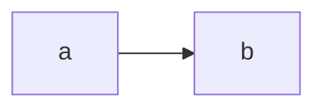

# Fixture README

Fixture for manifest/test-readme.ts. It ships `alpha-skill` and `beta-skill`.

See [a sibling fixture](missing-skill.md), [a heading](#fixture-readme), [the web](https://example.com/page) and [mail](mailto:someone@example.com).

Formerly known as Muleteer.

[ref]: three-diagrams.md#section

```bash
# Inside a code fence this is not a link: [x](nowhere.md)
```




